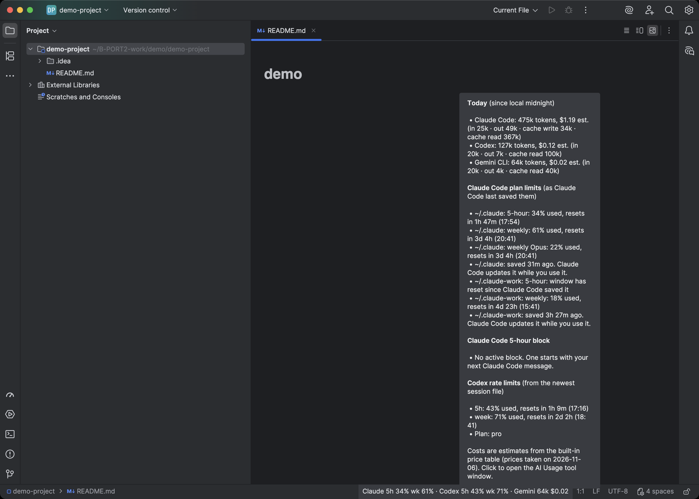
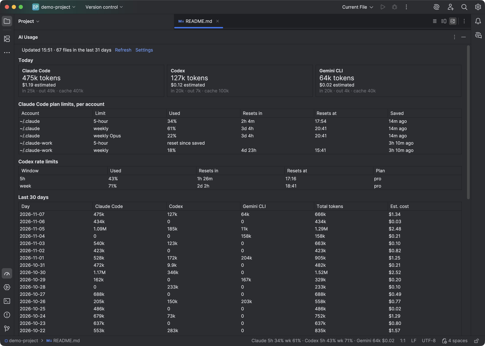
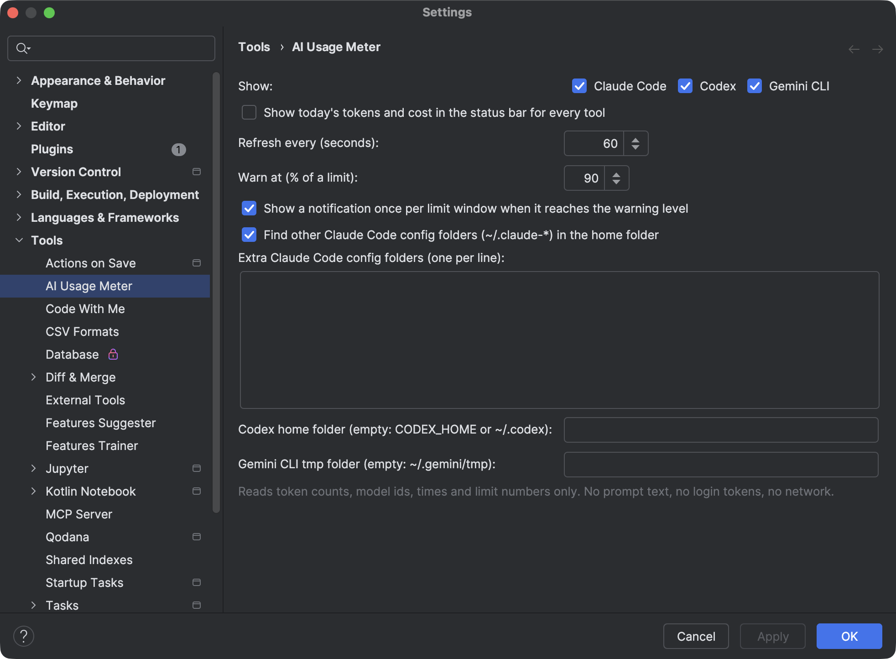

# AI Usage Meter for JetBrains IDEs (Claude Code, Codex and Gemini CLI)

Your Claude Code, Codex and Gemini CLI usage in the IDE status bar, read offline from local files. It works in IntelliJ IDEA, PyCharm, WebStorm, GoLand, Rider and every other IntelliJ-based IDE from 2025.2 on.



## What it shows

- The status bar shows a short line such as `Claude 5h 34% wk 61% · Codex 5h 43% wk 71% · Gemini 64k $0.02`. Hover it for today's tokens and estimated cost per tool. Click it to open the AI Usage tool window.
- Claude Code plan limits come from what Claude Code saves on your disk (`cachedUsageUtilization` in `.claude.json`): the 5-hour and weekly percent and the reset times. Team plans that keep only a per-model weekly limit are read too.
- Each `CLAUDE_CONFIG_DIR` folder, such as `~/.claude-work`, counts as its own account with its own limits.
- Codex rate limits (the 5-hour and weekly windows and the plan name) come from your newest Codex session.
- Gemini CLI tokens and estimated cost come from its session files.
- The tool window has today by tool, limits per account, the last 30 days and a table of models.
- A notification shows once per limit window when it reaches the level you set (90% by default).



## Offline and private

No login, no API key, no network calls. The plugin keeps only token counts, model ids, times and limit numbers. It does not keep or show prompt text or replies, and it never reads login tokens.

- Claude Code: `~/.claude/projects/**/*.jsonl` (or each `CLAUDE_CONFIG_DIR`) and `cachedUsageUtilization` in `~/.claude.json`.
- Codex: `~/.codex/sessions/**/rollout-*.jsonl` (or `CODEX_HOME`).
- Gemini CLI: `~/.gemini/tmp/*/chats/session-*`.

Each pass reads only the lines added since the last one, on a background thread, once a minute by default. Costs are estimates at public API prices (taken on 2026-11-06); subscription plans are not billed per token.

## Settings

Settings | Tools | AI Usage Meter: which tools to show, tokens and cost in the status bar, the refresh interval, the warning level, extra Claude Code config folders, and the Codex and Gemini CLI folders.



## Same numbers as the VS Code version

The parsers are a Kotlin port of the [AI Usage Meter for VS Code](https://marketplace.visualstudio.com/items?itemName=zovo.ai-usage-meter). `src/test/resources/fixtures` holds synthetic session files (no real sessions), and `src/test/resources/parity/expected.json` holds the numbers the JavaScript version gives for them. `ParityTest` checks that the Kotlin version gives the same ones.

## Build

```
export JAVA_HOME=<JDK 17 or newer>   # Gradle fetches the JDK 21 toolchain
./gradlew test verifyPlugin buildPlugin
./gradlew runIde -PdemoHome=<folder with .claude, .claude-work, .codex and .gemini>   # sandbox IDE on demo data
```

## Support

Free and open source (MIT). Issues and ideas: [GitHub issues](https://github.com/theluckystrike/ai-usage-meter-jetbrains/issues). If it helps you, you can [sponsor it on GitHub](https://github.com/sponsors/theluckystrike).

More tools by Zovo:

- [Context Drift](https://plugins.jetbrains.com/plugin/35875) for JetBrains IDEs: finds commands, paths and versions in AGENTS.md and CLAUDE.md that no longer match your repo.
- [AI Usage Meter](https://marketplace.visualstudio.com/items?itemName=zovo.ai-usage-meter) for VS Code.
- [Claude Code History & Codex History Viewer](https://marketplace.visualstudio.com/items?itemName=zovo.agent-session-viewer) for VS Code.
- [JSONL Viewer & NDJSON Viewer](https://marketplace.visualstudio.com/items?itemName=zovo.zovo-jsonl-viewer) for VS Code.
- All tools: [theluckystrike on GitHub](https://github.com/theluckystrike).

Not affiliated with Anthropic, OpenAI or Google.
